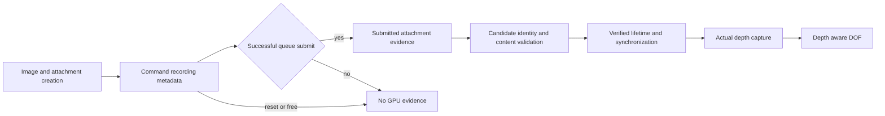

# Vulkan depth adapter: passive provenance stage

This code identifies depth attachments from the application's Vulkan resource
and command stream. It does **not** expose a depth/DOF/normal capability to the
editor and does not pretend that the presented color image contains depth.

`depth_provenance.h` copies creation metadata for depth images, image views,
render passes, framebuffers and command pools. It records render-pass and dynamic
rendering attachments per command buffer, then emits observations only after a
successful queue submission. Reset, free and pool destruction discard abandoned
recordings. Image generations distinguish a destroyed resource from a later
resource that reuses the same Vulkan handle. Imageless framebuffers, subpasses,
multiview metadata and secondary command execution are represented explicitly.

`depth_probe.h` writes a compact JSONL sample once per 60 presentations when
`CS2_CAMERA_DEPTH_PROBE` is set to an explicit path. A process-session value and
device serial keep separate devices identifiable. Resource maps and event lists
are bounded; overflow is reported. Allocation failures disable observation, not
the underlying game call.

`depth_probe_layer.h` forwards the original Vulkan calls with their original
arguments and reports successful results. It does not add transfer/sampled usage,
change layouts, add GPU commands, submit new work or wait for GPU idle. Allocation
uses the existing overlay allocation helper to initialize command-buffer loader
data. Extension wrappers are returned only when the next Vulkan layer provides
the original function. No probe wrappers are advertised with the environment
variable unset.

The overlay includes this opt-in diagnostic path. With
`CS2_CAMERA_DEPTH_PROBE` unset, device and instance lookups retain the original
Vulkan functions. The production-overlay dispatch test covers both settings,
including loader-data initialization, allocation failure cleanup and unavailable
extension functions. No live-game depth provenance has been established.

## What a sample establishes

An observation establishes that a tracked depth attachment appeared in submitted
Vulkan commands. `presentation_extent_match` is only a useful candidate filter.
`layout_at_pass_end` describes the render-pass contract; it is **not** a claim
about the resource's current layout at presentation. A later barrier, clear,
aliasing allocation or queue operation can change its state or contents.

Every sample explicitly reports `depth_available: false` until the remaining
conditions below are independently validated.

## Remaining implementation gates

1. Run a root-owned `-insecure` offline demo with the passive probe and obtain
   real submitted attachment records. The renderer contains entry-point strings
   for renderpass 1/2, dynamic rendering and queue submit 1/2; static strings alone
   do not identify the path actually used by this build.
2. Match a candidate to the main camera through actual content and viewport
   evidence. Matching width and height is insufficient: shadow maps, weapon
   views and postprocessing targets can have the same dimensions.
3. Prove the candidate's sample count, format, image/view subresources, storage
   operation and transfer/sampled capabilities. A store operation of `DONT_CARE`
   does not preserve data after the pass. A multisampled depth image cannot be
   copied to a readback buffer as a single-sample image.
4. Capture at a validated point while contents are preserved. Respect final and
   subsequent layouts, all relevant queue ownership/synchronization, command
   recording versus submission, reset, resize and resource destruction. Do not
   copy an arbitrary engine image during `QueuePresentKHR`.
5. Validate real depth pixels with Vulkan synchronization validation and compare
   them with the same game frame. Establish projection/depth convention before
   implementing focal distances. Add capture/export coverage before claiming
   functional DOF.
6. Obtain actual normals/albedo/material data for relighting. A grayscale color
   image, estimated monocular depth, or color-edge pseudo-normal is not the
   game's depth or normal buffer.



## Reproduce local checks

From the worktree:

```sh
python native/live/tests/run_depth_provenance_test.py --sanitize
```

This runs the provenance model and the original-call forwarding wrappers under
AddressSanitizer and UndefinedBehaviorSanitizer, with the probe disabled and
enabled. It does not launch CS2 or create a Vulkan device. Run
`python native/live/tests/run_overlay_vulkan_dispatch_test.py` to compile and
exercise the actual overlay dispatch in both configurations.
